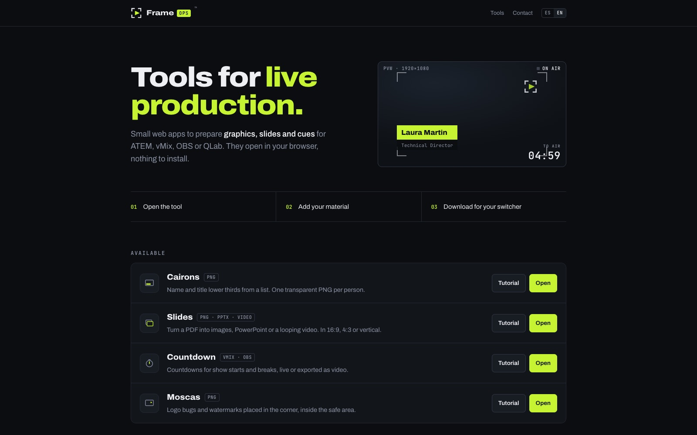
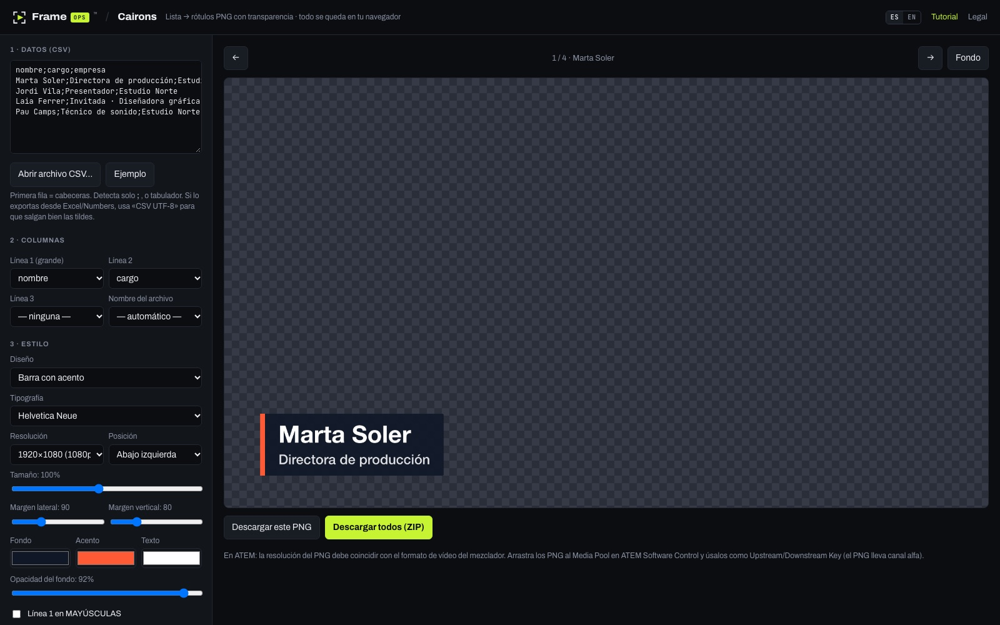
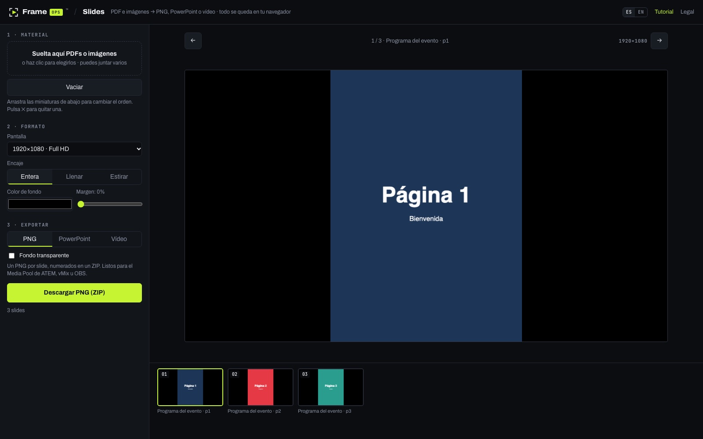
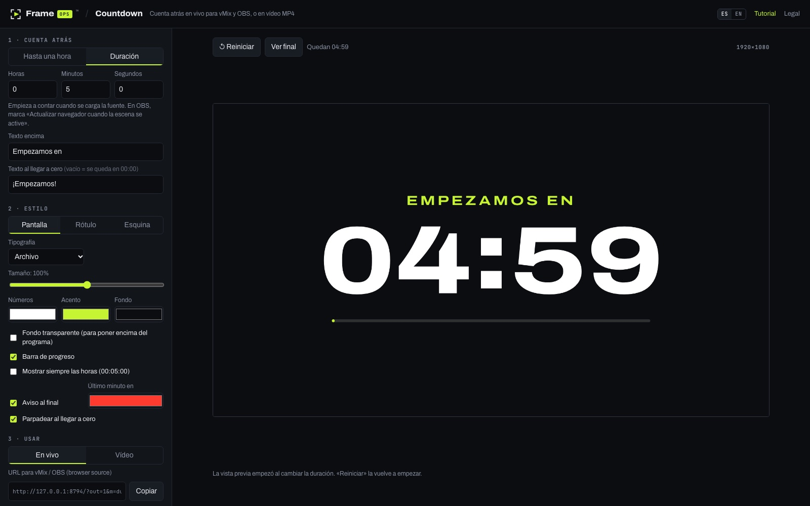
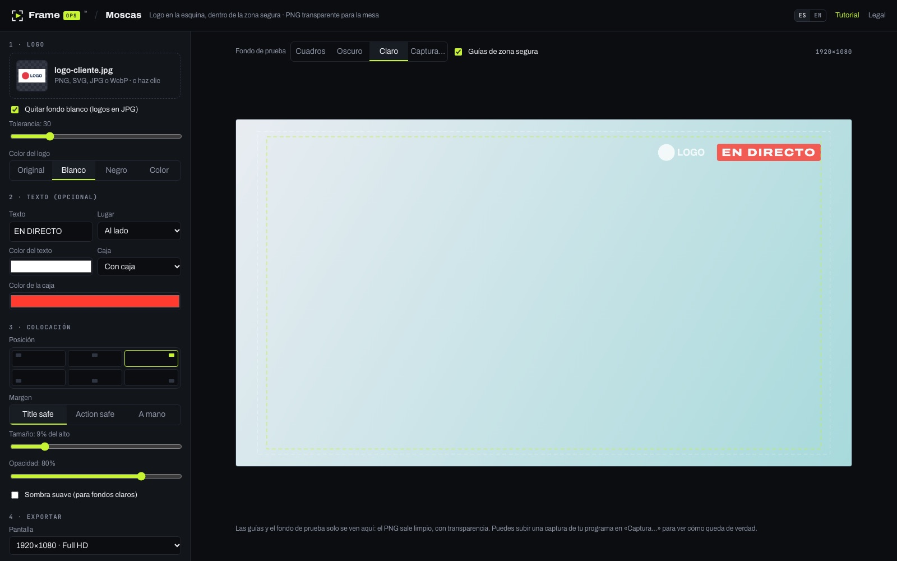

# FrameOps™ — herramientas web para producción en directo

[English](README.md) · **Español**

> Herramientas gratuitas que funcionan en el navegador y ayudan a los técnicos de eventos en directo a preparar gráficos, slides y cues para **ATEM, vMix, OBS y QLab**. Sin instalar nada, sin cuenta y sin subir archivos.

**En vivo:** [runframeops.com](https://runframeops.com) · Diseñado, desarrollado y lanzado en solitario por **Argos Anton** (técnico audiovisual y desarrollador, Barcelona).

> ℹ️ Este repositorio es un **escaparate del proyecto**. El código fuente es privado; todo lo que se describe aquí se puede probar en vivo en los enlaces.

---

## El problema

Trabajo como técnico audiovisual en shows y eventos en directo. Antes de cada evento se repiten las mismas tareas pequeñas: los rótulos de cada ponente, el PDF del cliente convertido en algo que el mezclador pueda reproducir, una cuenta atrás para el descanso, la mosca del logo en la esquina correcta. Lo habitual es tirar de Photoshop, After Effects o un plugin de pago: lento, caro y muchas veces no está instalado en el portátil del recinto.

**FrameOps** convierte cada una de esas tareas en una página web con un solo propósito: la abres, metes tu material y descargas un archivo listo para el mezclador.

## Las herramientas

| Herramienta | Qué hace | Resultado |
|---|---|---|
| [**Cairons**](https://cairons.runframeops.com) | Rótulos (nombre + cargo) generados en lote desde un CSV u hoja de cálculo | Un PNG transparente por persona, o todos en un ZIP |
| [**Slides**](https://slides.runframeops.com) | Convierte PDFs e imágenes en slides para pantalla en 16:9, 4:3, vertical o a medida | Secuencia PNG, PowerPoint con avance automático en bucle, o MP4 H.264 |
| [**Countdown**](https://countdown.runframeops.com) | Cuentas atrás para inicios y descansos, hasta una hora fija o por duración | URL en vivo para *browser source* de vMix/OBS, pantalla completa o MP4 |
| [**Moscas**](https://moscas.runframeops.com) | Moscas y marcas de agua colocadas dentro de la zona segura (title/action safe) | PNG transparente a pantalla completa, key opcional en blanco y negro, 4 esquinas en un ZIP |

Cada herramienta incluye un **tutorial** paso a paso en español e inglés.

<table>
<tr>
<td width="50%"> <b>Cairons</b> — entra un CSV, salen rótulos transparentes</td>
<td width="50%"> <b>Slides</b> — PDF a PNG, PPTX en bucle o MP4</td>
</tr>
<tr>
<td width="50%"> <b>Countdown</b> — panel de control; la configuración viaja en la URL</td>
<td width="50%"> <b>Moscas</b> — logo dentro de la zona segura</td>
</tr>
</table>

## Cómo está hecho

**Todo se ejecuta en el navegador.** Los archivos no salen nunca del ordenador del usuario: sin backend, sin base de datos y sin subidas. Así el coste de hosting es casi cero, no hay que custodiar material de clientes (a menudo confidencial antes de un evento) y las herramientas funcionan en ordenadores de recinto bloqueados.

Parte del trabajo técnico:

- **Codificación de vídeo en el navegador** — Slides y Countdown dibujan los fotogramas en un canvas y los codifican a **MP4 H.264** con la **API WebCodecs** (`VideoEncoder`) y `mp4-muxer`, sin ffmpeg ni servidor.
- **Renderizado de PDF** con `pdf.js` y **generación de PowerPoint** con `PptxGenJS` (las slides avanzan solas y se repiten en bucle, listas para pantallas desatendidas).
- **Exportación de PNG transparente** con canal alfa a resoluciones de emisión (720p / 1080p / 4K), ajustada a lo que esperan ATEM, vMix y OBS.
- **Empaquetado ZIP escrito a mano** (CRC-32 incluido) en Cairons para descargar un lote entero de gráficos en un solo archivo sin dependencias extra.
- **Salida en vivo sin estado** — Countdown guarda toda su configuración en la URL (`?out=1&…`), así que se pega en un *browser source* de vMix/OBS y se sincroniza con el reloj del ordenador sin servidor.
- **Lectura de CSV** tolerante con exportaciones reales (detecta `;`, `,` o tabulador; tildes en UTF-8).
- **Capa de idiomas ligera** (ES/EN) compartida por todas las herramientas, con detección del idioma del navegador, parámetro `?lang=` y memoria de la elección.
- **Sistema de diseño compartido** — cabecera común, colores y tipografías autoalojadas (Archivo + JetBrains Mono) en cinco webs; sin Google Fonts ni rastreadores de terceros.

**Stack:** HTML, CSS y JavaScript sin framework ni paso de compilación · WebCodecs · Canvas · pdf.js · PptxGenJS · JSZip · mp4-muxer · Vercel (un proyecto por herramienta, despliegue al hacer push a `main`) · dominio propio con subdominios · Vercel Web Analytics (sin cookies).

## Producto, no solo código

FrameOps funciona como un pequeño producto de principio a fin:

- **Marca e identidad** — nombre, logo, sistema de color y tipografía diseñados desde cero; marca solicitada en la Oficina Española de Patentes y Marcas (OEPM, clases 9 y 42).
- **Infraestructura** — 5 webs en dominio propio con un subdominio por herramienta, DNS y correo con la marca.
- **Legal y privacidad** — aviso legal, privacidad y cookies en dos idiomas; privacidad desde el diseño (sin cookies ni datos personales).
- **Marketing** — lanzamiento en Instagram con carrusel, posts y reels programados. Las imágenes y vídeos promocionales también se **generan con código**: plantillas HTML → capturas de las herramientas reales con Chrome headless (DevTools Protocol) → Python + ffmpeg para montar los reels.
- **Hoja de ruta guiada por los usuarios** — las próximas herramientas (*Polls*: votación del público por QR; *Cue Prep*: preparar medios para QLab) tienen un botón «Avísame» para que la demanda decida qué se construye después.

## Qué dice de cómo trabajo

- Construyo herramientas para problemas que me encuentro en mi propio trabajo y las lanzo rápido (de la primera herramienta a cinco webs en producción en una semana, aproximadamente).
- Aprovecho las APIs modernas del navegador para no depender de servidores cuando no hacen falta.
- Me ocupo del conjunto: experiencia de uso para gente no técnica con prisa, documentación, contenido bilingüe, legal, marca y lanzamiento.

---

**Contacto:** [hello@runframeops.com](mailto:hello@runframeops.com) · [runframeops.com](https://runframeops.com) · Instagram [@runframeops](https://instagram.com/runframeops)

FrameOps™ es una marca solicitada por su titular. Capturas © FrameOps. No incluye código fuente.
